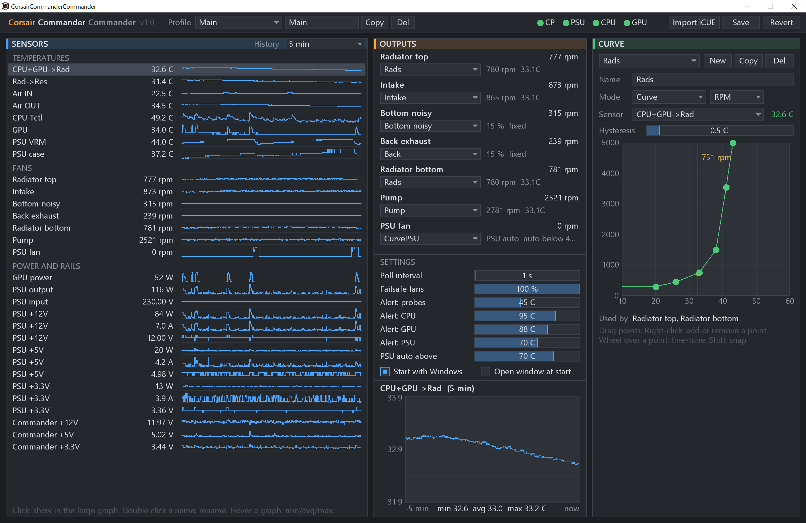

# CorsairCommanderCommander

### A small replacement for iCUE that only does fan control: Corsair Commander Pro and HXi/RMi power supplies



iCUE can be considered by some to be bloatware. It definitely has far more than what most people with a Commander Pro actually need: temperature readout and fan speed adjustment. The services poll the hardware constantly and keep the CPU from idling, as well as eating a bunch of RAM for no good reason.

This app reads the Commander Pro's temperature probes, the CPU and GPU temperatures and the PSU's own sensors once per poll interval (1s by default), sets the fans from defined curves, and does nothing in between. No lighting, no animations, no background services. It can import your existing iCUE fan curves, so switching over takes a few minutes.

## WARNING: AI SLOP AHEAD
### 95% of this project is unadulterated LLM-generated garbage. Treat it as such.
I'm only releasing it because it might help you avoid the frustration that I had with iCUE's bloat.

If you like well-written, maintainable code, perhaps look elsewhere. I mostly just defined the requirements/spec and cleaned up some of the code, but it's still not good.

The software works, and does what it says on the tin. Don't expect anything more than that.

## What it does

- Reads the Commander Pro's 4 temperature probes, 6 fan speeds and its rail voltages.
- Reads the PSU's temperatures, fan speed, input voltage, output power and per-rail voltage, current and power.
- Reads the CPU temperature (Tctl and per-CCD, AMD Ryzen) and the GPU temperature and power (NVIDIA).
- Drives every Commander Pro fan header and the PSU fan from a fan curve, a fixed value, or (PSU only) the PSU's own fan logic.
- Curves can be in percent or in RPM. In RPM mode the Commander Pro regulates the fan to that speed itself, the same way iCUE's curves work, except Curves go all the way down to 0 %, which can stop PWM fans.
- Profiles: each one holds which curve drives which fan. Switchable from the window or the tray menu.
- History graphs for every reading and fan, from 30s up to an hour. Not written to disk.
- Warns you with a message box when something is wrong: a temperature over your limit, a sensor reading nonsense, a fan that should be spinning but isn't, a device that stopped responding, or iCUE running at the same time.

## What it doesn't do

Anything else. I only added what I wanted. The UI isn't super polished.
Feel free to have your own clanker extend it and open a PR if you think it's beneficial to others. Don't bring in UI frameworks or other bloat.

## Supported hardware

| Device | Notes |
|---|---|
| Corsair Commander Pro | Tested |
| Corsair RM750i | Tested |
| Other RMi and HXi PSUs (RM650i–RM1000i, HX750i–HX1500i) | Same protocol, untested |
| AMD Ryzen (Zen 2 and newer) | CPU temperature, needs PawnIO |
| NVIDIA GPUs | GPU temperature and power, through the NVIDIA driver |

Intel CPUs and AMD GPUs aren't read. You can still drive fans from the Commander Pro's probes, which is the better choice for water loops anyway.

## Setup

1. **Get rid of iCUE first.** iCUE and this app can't both talk to the same devices; they corrupt each other's readings. Either uninstall iCUE, or open `services.msc`, stop every service with Corsair or iCUE in its name and set them to Disabled, then remove iCUE from startup in Task Manager.
2. **Other monitoring tools:** if you use HWiNFO, turn off its Corsair/Asetek support (Settings, Safety tab). Same problem as above.
3. **Optional, for the CPU temperature:** install [PawnIO](https://pawnio.eu). It's a small signed driver that other monitoring tools use too. Everything else works without it.
4. Download the latest build from the Releases page and run it. There's no installer; wherever you put it is where it lives. It asks for administrator rights because PawnIO needs them.
5. On the first start it looks for iCUE's settings in `%APPDATA%\Corsair\CUE5` and imports your fan curves, which curve drives which fan, and the names you gave the probes and fans. If you skipped that, or want to redo it, press **Import iCUE**.
6. Check that the fans are doing what they did under iCUE, then leave it in the tray. **Start with Windows** is on by default.

## Using it

**Sensors (left).** Every temperature, fan speed and power reading with a small history graph. Pick the time span
at the top. Click a row to show it in the large graph under Settings, or just hover one to see it there for a
moment. Double click any name to rename it.

**Outputs (middle).** Each fan header and the PSU fan, with the curve driving it, its current speed and what it
was last told to do. Clicking an output opens its curve on the right.

**Curve (right).** Create, copy, rename and delete curves.
- *Mode*: Curve, Fixed, or Device auto (the PSU's own logic).
- *Unit*: Percent or RPM.
- *Sensor*: which temperature drives the curve.
- *Hysteresis*: how many degrees the temperature has to drop before the fans slow down again, so they don't hunt up and down around a point.
- Drag points to move them. Right-click empty space to add a point, right-click a point to remove it. The mouse wheel over a point fine-tunes it, and holding Shift while dragging snaps to coarser steps.

**The PSU fan.** In software control the HXi/RMi PSUs won't run their fan below roughly 33% of full speed, so you can't get the fan to stop with a curve alone. When a curve drives the PSU fan, its graph gets an orange **A** marker: below that temperature the PSU's own fan logic takes over, which keeps the fan stopped at low load. Drag it to set the temperature; right-click it to turn it off. Corsair doesn't publish the temperature its own logic starts the fan at; it's specified as roughly 40 % load. Around 45 °C on a PSU temperature sensor is a reasonable starting point.

**Settings.** Poll interval, the failsafe fan speed, alert limits, and the temperature above which the PSU fan is
always handed back to the PSU, whatever your curve says.

## Safety

- If a curve's sensor stops reading, the Commander Pro fans on it go to the failsafe speed (70 % by default) and the PSU fan goes back to the PSU's own logic.
- If the PSU gets hotter than the "PSU auto above" setting, the PSU's own logic takes over until it has cooled down by 5 °C.
- When you quit, and when the PC goes to sleep or shuts down, the Commander Pro fans go to the failsafe speed and the PSU fan goes back to its own logic. Nothing is left on a low fixed speed with nobody watching.

## Config file

Everything is saved in `%APPDATA%\CorsairCommanderCommander\config.ini`. It's plain text.

## Command line

| Option | What it does |
|---|---|
| `--show` | Open the window on start |
| `--quit` | Close the running copy cleanly (fans to failsafe, PSU to its own logic) |

## Build

Windows only. Needs CMake and Visual Studio 2019 or newer (MinGW-w64 works too).

```
cmake -S . -B build
cmake --build build --config Release
```

## License

CorsairCommanderCommander is licensed under MIT, see [LICENSE](LICENSE).

It embeds the AMDFamily17 module from [PawnIO.Modules](https://github.com/namazso/PawnIO.Modules) (LGPL 2.1) for the CPU temperature. The device protocols were worked out from [liquidctl](https://github.com/liquidctl/liquidctl) and the Linux `corsair-cpro` driver. See [THIRD_PARTY_NOTICES.md](THIRD_PARTY_NOTICES.md).

## Disclaimer

Neither this project nor the author are affiliated with Corsair, any linked entities, trademarks. No copyright claimed over existing IP.